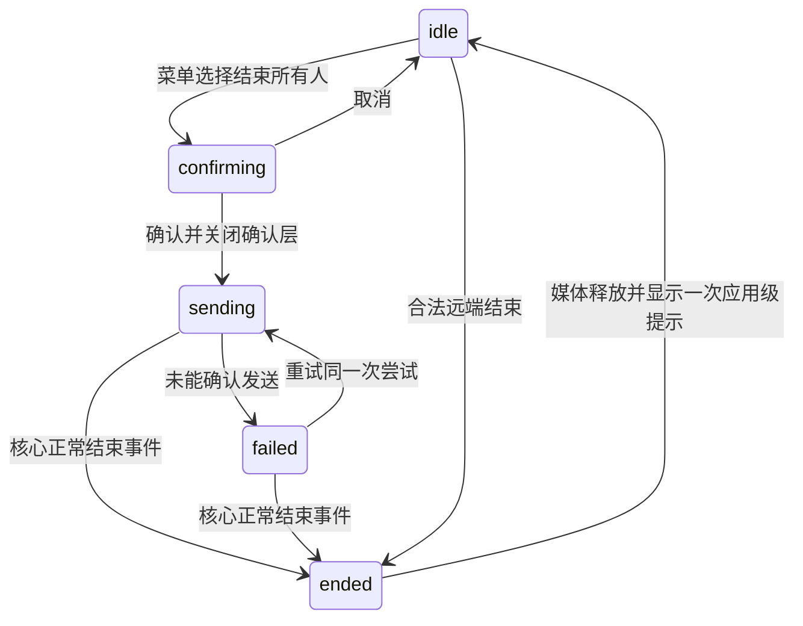

# Sable 原生通话：结束所有人与定制 Element Call 双向兼容

状态：Web 已由用户手工测试并确认无问题，本轮 Web 验收通过；Electron 延后，不阻塞当前交付。Issue 保持 open。

执行方式：主代理调度和审核；核心与前端 worker 分别实现。

工作目录：/home/zhuji/code/element/red-sable。

来源：用户确认的 `docs/plans/native-call-end-for-everyone.md` 与配套执行提示词；2026-11-08 按用户最新要求迁入 CodeStable。

## 交付结论与使用入口

Sable 原生通话已增加“结束所有人的通话”，普通挂断仍只退出本人。Web 最终候选已构建，生成 WASM 位于 `src/generated/wasm/`，静态站点位于 `dist/`。开发入口保持 `http://localhost:3001`：先结束已有通话、关闭旧标签页，重启本地 Vite 服务后重新打开，避免复用旧核心。

参与通话且存在其他设备/参与者时，使用红色挂断右侧菜单 → **结束所有人的通话** → 确认。发送失败可重试或只退出自己。用户已自行登录测试 Web 界面并确认没有问题；原手测清单与组合索引保留供后续排障或恢复 Electron 工作时使用。

本轮独立复审修复了立即重新加入与旧成员撤销竞争的问题，核心定向 **15 项通过**，Web release WASM 与 Vite 重新构建通过；详见第 13 节。未变化的前端复用会话 81 项、浏览器组件 8 项、隔离 Playwright 2 项及静态检查证据。Electron TypeScript 检查通过，native/audio bundle 因缺少系统开发包未构建；用户选择不安装，并已明确将 Electron 延后。Web 手工验收来自此前用户反馈，未逐项提供对端、房间类型、方向和平台版本，不将其扩写为此次修复后的真实互通结果。

代码位置、关键审核修复及检查口径见 [第 12 节执行记录](#12-本轮执行记录)。本次未关闭 Issue；稳定能力的 Project Spec 毕业回写留待用户授权收尾。

### 最新验收决定

用户反馈：“我测试完了，在 web 界面，没有问题。electron 之后再说吧，目前不是刚需。”据此接受本轮 Web 交付，停止追加测试；Electron 构建和互通待用户以后重新提出时恢复。下面保留原协议及验证设计，Electron 项目不再是本轮交付条件。

## 1. 本期交付与明确不做的事

在 Sable 自带通话中增加“结束所有人的通话”，与用户的定制 Element Call 使用同一结束协议，实现双方发起、对方退出。保留现有 Svelte 界面、Rust Matrix 核心和 LiveKit 媒体传输，不嵌入 EC，不引入 React 或 matrix-js-sdk。

### 已确认决策

| 项目       | 决定                                                                                             |
| ---------- | ------------------------------------------------------------------------------------------------ |
| Sable 平台 | 本轮 Web（用户实测通过）；Electron 桌面端延后                                                    |
| 对端       | 本地定制 EC 的独立网页、加载该 EC 的 Element Web、加载该 EC 的 Element X；联调记录实际平台和版本 |
| 房间       | 普通房间、加密房间均为必验                                                                       |
| 发起权限   | 任意当前通话参与者；不额外引入房主或管理员条件；仍遵守服务器已有的事件发送权限                   |
| 结束效果   | 结束当前这轮通话，退出媒体和通话成员关系；不退出聊天房间、不踢人、不封禁，之后可以重新发起或加入 |
| 本人离开   | 原有普通挂断只退出自己，绝不顺带发送全员结束消息                                                 |
| 交互       | 挂断菜单区分本人离开与结束所有人，结束所有人需二次确认；发送中防重；失败可重试，也可只退出自己   |
| 收到通知   | 正常退出并提示由谁结束，不表现为连接失败                                                         |
| 画质       | 用户最后选择 A：所有画质设置、选项、默认值、存储和生效时机保持现状；不补摄像头帧率，不做即时应用 |
| 修改范围   | 只修改 red-sable；element-call 只读；服务器配置不改                                              |
| 远端操作   | 实际联调开始前联系用户，确认测试账号、房间和本次操作；不得对生产或未确认的房间试验               |
| Git 和部署 | 不自动 commit、push、开 PR、发布或部署                                                           |

兼容承诺针对实现本协议的定制 EC。未实现该协议的客户端可能继续通话；普通音视频互通不等于支持结束所有人。一次成功发送表示服务器接受消息，不表示所有远端已经确认退出。离线客户端、网络断开的客户端不能被本功能强制即时断开。

### 非目标

- 不改 LiveKit 服务器、不增加服务器踢人接口，不关闭房间准入，不修改 RTC slot 为永久关闭。
- 不增加成员能力探测协议，不猜测哪些参与者支持此功能。
- 不移植 EC 的布局、虚拟背景、画中画、画质设置等其他功能。
- 不调整通话模式选择、SFU 选择、媒体 E2EE 算法、设备权限、现有媒体编码参数。
- 不以 Sable Android、iOS、Tauri 客户端为本期产品验收对象；共享核心的必要改动不能破坏既有调用契约。
- 计划和改动记录归入 `codestable/`（用户 2026-11-08 最新要求）；不升级依赖、不更换 SDK、不做广泛重构。

## 2. 源码基准与现有工作保护

调研时的源码身份：

| 项目    | 路径                                  | HEAD                                     |
| ------- | ------------------------------------- | ---------------------------------------- |
| Sable   | /home/zhuji/code/element/red-sable    | 3b015fc72151bffb0eeecd33f76af33392707713 |
| 定制 EC | /home/zhuji/code/element/element-call | 0ac3d6e07a4f2a6204deaa097175f72d2fb8e7e5 |

执行前只读检查当前 HEAD 和工作区差异。若有变化，核对本任务相关文件，不 reset、不切换到旧提交覆盖用户工作；只有相关协议或授权范围发生冲突时才询问用户。

Sable 在制定方案前已有：README.md、src-tauri/tauri.conf.json、vite.config.ts 修改，以及未跟踪的 README_zh.md、.serena/。它们不是本任务成果，不覆盖、不清理。EC 工作区在调研时无未提交差异。

CONTRIBUTING.md 含上游拒收 AI 生成贡献的规则。本任务是用户工作副本的定制，不向上游提交。沿用其类型生成、测试和代码规范；不要创建假签名或自动 DCO 提交。

### 必读的相关代码

| 用途                  | 文件与定位                                                                                                                                         |
| --------------------- | -------------------------------------------------------------------------------------------------------------------------------------------------- |
| EC 发送协议           | ../element-call/src/callTermination/index.ts；../element-call/src/reactions/events.ts                                                              |
| EC 接收准入           | ../element-call/src/callTermination/CallTerminationReader.ts，读完整文件                                                                           |
| EC 发送状态和失败重试 | ../element-call/src/state/CallViewModel/CallViewModel.ts 的 terminateCall、leave$、stopTermination、cancelFailedTermination                        |
| EC Widget 能力        | ../element-call/src/widget.ts 的 sendRecvEvent；../element-call/src/callTermination/CallTerminationTransport.test.ts                               |
| EC 语义测试           | ../element-call/src/callTermination/CallTerminationReader.test.ts；相关 CallViewModel 测试                                                         |
| Rust 会话所有权       | crates/sable-core/src/lib.rs 的 CallSession；calls/runtime.rs 的 State、join、join_handlers、refresh、updates；calls/mod.rs 的 leave_call、hang_up |
| 成员身份与代次        | crates/sable-core/src/calls/membership.rs 的 CallMember、same_generation、active_members；sticky.rs                                                |
| RPC 和事件            | crates/sable-core/src/api/calls.rs；crates/sable-core/src/protocol.rs；src/generated/protocol.ts                                                   |
| 普通自定义事件发送    | crates/sable-core/src/api/messages.rs 的 SendRawEventParams，仅参考，不能让 UI 拼任意结束消息                                                      |
| 前端会话              | src/lib/features/call/call-session.svelte.ts，重点 join、事件缓冲、#apply、leave、#teardown、#performTeardown                                      |
| UI                    | CallControls.svelte、CallView.svelte、ActiveCallBar.svelte、CallRouteMenu.svelte、CallDeviceMenu.svelte                                            |
| 应用生命周期          | src/routes/(app)/+layout.svelte；通话快捷键和系统挂断调用点                                                                                        |
| 可复用 UI             | src/lib/ui/primitives/ActionMenu.svelte、ActionMenuItem.svelte、ConfirmDialog.svelte；src/lib/ui/toasts.svelte.ts                                  |
| 测试和生成            | docs/TESTING.md、vitest.config.ts、playwright.config.ts、.mise/config.toml、electron/package.json、electron/build.mjs                              |

不要将 calls/runtime.rs 已有的 terminate 函数误认为本功能：它目前是信令故障清理并发出 CallSignalingError，本功能应走正常结束路径。

## 3. 不可改变的跨客户端协议

### 3.1 发送格式

发送普通 Matrix message-like 房间事件，解密后的类型为：

```text
io.element.call.reaction
```

解密后的 content 为：

```json
{
  "io.element.call.terminate": {
    "terminated_by": "@alice:example.org",
    "timestamp": 1790000000000
  }
}
```

- terminated_by 由 Rust 当前登录用户身份生成，不能相信前端传入的 user ID。
- timestamp 是首次确认发送时的 Unix 毫秒数；同一次失败重试保留原值。
- reason 是 EC 接收端允许的可选字符串，本期不增加原因输入框、不要求此字段。
- 不添加 emoji、reaction relation 或聊天 body；这是一条控制消息，不是表情反应。
- 不要求对端提供新的 call_id、session_id、device_id、版本号或确认消息；现有 EC 不发送这些字段。
- 不使用 m.call.hangup，不使用 io.element.close 或 im.vector.hangup 代替全员结束。
- 新发送端只发送上述一种格式，不同时发送旧格式，否则会产生重复控制事件。

### 3.2 兼容旧接收格式

与 EC 一样，接收时也识别旧的 io.element.call.terminate 事件类型，其 content 直接是 terminated_by、timestamp、可选 reason。新旧两种格式都执行相同校验、去重和会话边界规则。

不要把所有 io.element.call.reaction 当成结束：只有具有明确 io.element.call.terminate 命名空间、且内容合法的信封才是结束请求。普通 emoji、m.reaction、聊天消息和畸形命名空间不能触发离会。

### 3.3 加密发送

通过当前已登录 Matrix SDK 的 Room::send_raw 发送，并使用 with_transaction_id 指定事务 ID。按房间已有加密策略由 SDK 处理；不得手工 HTTP 绕开加密，不得把媒体 E2EE 密钥当成房间消息密钥，也不得为此改变房间加密状态。

当前锁定的 matrix-rust-sdk 提供这些 API：

- room/mod.rs：Room::send_raw。
- room/futures.rs：SendRawMessageLikeEvent::with_transaction_id。
- encryption/mod.rs：room_keys_received_stream。
- room.decrypt_event 已在 Sable 的 calls/sticky.rs 中使用。

本地参考路径为 ~/.cargo/git/checkouts/matrix-rust-sdk-a2cca517fb3c9e8a/c1f7808/；路径可能随运行环境不同，执行者以 Cargo.lock 对应源码为准，不需要升级 SDK。

## 4. 接收准入：移植 EC 的行为，不只移植 JSON

Rust 内新增小而独立的 termination 模块，包含信封解析、准入状态和单元测试；与现有会话运行时衔接，不将其变为全局聊天消息监听器。

### 4.1 必须满足的条件

1. 消息来自当前通话房间的实时接收路径，具有 event ID 和实际 sender；不是翻页、搜索、缓存回放或未发送的本地回显。
2. 是 message-like 事件，不是 state 事件；内容符合 3.1 或 3.2。
3. origin_server_ts 和 content.timestamp 都为正、有限数值；读取 JSON 时拒绝错误类型、空对象和不能表示的数值。
4. terminated_by 与 Matrix 事件实际 sender 完全一致；有 reason 时必须为字符串。
5. sender 是当前 RTC 通话中实际观察过的参与者；不是只要加入聊天房间就有结束权。
6. 使用当前房间、当前 RTC slot、当前通话代次的成员记录。若需要补充成员事件 ID 等内部元数据，保持现有 CallMemberView 和其他调用者语义不变。
7. 使用本账号“本设备”的入会边界，而不是同账号另一台设备更早的入会时间；边界只能前移，不能倒退。
8. 事件 origin_server_ts 不得早于本设备本轮入会边界；不得早于被采用的发送者成员记录创建时间。时间比较口径按 EC 源码，不能用 content.timestamp 代替服务器事件时间。
9. 成功准入的 event ID 去重；迟到解密、重复 sync、新旧路径重复交付不得再次结束或重复提示。

同账号不同设备发来的合法结束消息必须有效。不能简单地拒绝所有 sender == 当前用户的消息。对于本设备发出的事件，用 SDK 事务关联/已知事件 ID 区分本地发送确认，避免自身回显与 RPC 返回竞态造成错误提示。

### 4.2 成员离会时的容错

EC 当前常量：

| 规则                 | 值        |
| -------------------- | --------- |
| 已观察成员离会后宽限 | 30,000 ms |
| 离会边界事件时钟容差 | 5,000 ms  |
| 待解密实时事件上限   | 256       |
| 已接受 event ID 上限 | 256       |
| 已离会成员记录上限   | 256       |

如果某 sender 仍有当前成员记录，优先只使用当前记录进行准入；不能借其旧记录绕过重新入会边界。如果没有当前记录，允许在宽限期内使用已观察的离会记录，同时要求事件时间不晚于该记录离会时间加 5 秒。宽限不是赋予曾经参与过的人永久控制权。

当前 Sable CallMember 没有直接暴露 EC 使用的 membership event ID，执行时要对照成员解析链路确定最小内部补充，不能只用 user ID 作记录键，也不能误把每次轮询当成一次新加入。用成员代次/事件身份和相应时间测试证明映射正确。

### 4.3 普通事件、迟到解密与离开聊天页面

接收器属于 CallSession 运行时，不依赖聊天页面是否打开，也不依赖 Widget feed 是否开启。切换房间、折叠通话、Electron 窗口失焦不能停止监听。

先用固定版本 SDK 的最小测试确认实时事件分发行为：已解密事件能到达；未解密事件能保留其原始实时来源；晚到房间密钥后可以重试。不要假定一次 add_event_handler 回调天然包含晚到解密重发。

优先复用 SDK 已有实时分发与解密通知。如果需要自己补充：只保存本会话实时收到的未解密事件，限制为 256 项；由 room_keys_received_stream 等现有密钥通知触发本房间重试，解密在锁外进行。禁止轮询整个聊天历史、建立第二条 sync 或解密任意历史消息。晚到解密仍必须重新执行当前代次、成员、时间边界和 event ID 检查。

EC 的报文没有强制的全局 call-instance ID，因此不能声称协议提供了密码学级别的逐场绑定。本期按 EC 的实时来源、成员身份和时间规则兼容，实现并验证已知的旧事件/重入会隔离；不私自增加对端必须发送的新字段。

## 5. 会话所有权与发送、接收、清理的时序

### 5.1 单一所有者

Rust call session 拥有：协议、成员准入、发送尝试、事务 ID、结束决策、信令清理。前端 CallSession 拥有：UI 请求状态、媒体传输、设备资源、提示呈现。前端不能另发一份结束事件，也不能自行认定任意聊天事件可结束通话。

建议新增 RPC：calls.end_for_everyone，TypeScript 名称由现有生成器产生（预期 endForEveryone），参数仅传现有 CallSessionId。发送者、房间、事务 ID、时间都由核心确定。具体 Rust 类型名服从项目惯例。

RPC 成功含义：本轮结束事件已被服务器接受，或当前会话已被另一合法结束事件结束；不代表所有远端已 ACK。操作结果至少能让调用者区分已接受与发送失败；不要要求 UI 从普通异常文本推断业务状态。

新增正常事件建议为 CoreEvent::CallTerminated，至少携带 session、room_id、terminated_by、event_id 和足以区分“本设备请求成功/其他参与设备结束”的原因。不能复用 fatal CallSignalingError。字段实际命名可以调整，但需要贯通生成类型、前端、mocks 和测试。

### 5.2 发送路径

1. UI 确认后调用当前会话的 end_for_everyone。加入尚未完成或已离会时不可发起；本人离开始终可用。
2. 核心在会话锁下检查 session 与账号 generation，确定唯一发送尝试；并发第二次点击复用同一进行中的操作或明确返回 busy，不新建事务。
3. 首次尝试生成一个事务 ID、固定 content 和当前用户身份；失败重试复用事务 ID 和同一 content。SDK 的网络重试同样不得改变内容。
4. 释放会话/成员/global call_sessions 锁后执行网络发送。必须有可结束的失败结果，不能让 UI 无限处于发送中；使用项目/SDK已有请求策略，不搭建新的无限重试队列。
5. 服务器接受后，通过同一会话终止入口原子领取结束权。普通离开、远端结束或账号切换已抢先完成时，后到结果不能影响新通话。
6. 推送正常结束事件，让前端立即停止媒体；核心负责停止成员续期、撤销成员关系、取消延迟离会管理并执行既有 hang_up 清理。信令网络清理不能阻塞前端停止采集。
7. 失败且会话仍然有效：保留会话，返回失败并保留可重试事务。UI显示失败、重试和仅本人离开。

HTTP 失败可能发生在服务器已经接收之后。错误文案用“未能确认结束通知已发送”，不能断言其他人仍在通话。同一事务重试正是为了处理这一情况。

只采用一次性请求/有界 SDK 重试，不把控制消息放进会在下一场通话中后台补发的持久离线发送队列。普通离开/账号切换后，停止尚未完成的本地重试和解密任务。已经到达服务器的请求无法撤回；不要显示“取消了所有人的结束操作”。

### 5.3 接收路径与统一终止入口

合法结束信封 → 核心准入 → 原子领取当前 session 的终止权 → 核心发出正常结束事件并安排既有信令清理 → 前端按 session/generation 停止媒体、清空通话 UI并提示。

终止权领取要能处理：

- 两人同时点结束、同一事件重发、本设备回显与发送响应先后顺序任意。
- 普通 leave 与远端结束同时发生。
- 入会已经发布成员，但 join RPC 尚未返回时收到结束消息。
- 切账号、重新加入同一房间、加入另一个房间后旧异步回调才返回。

推荐将“从 call_sessions 取出会话、停后台任务、执行原有清理”的公共小段抽取出来，区分普通 leave 与全员结束；只有一个所有者执行信令清理。不要让网络 I/O 持有全局 call_sessions 锁，不在锁里调用会再次取同一锁的 leave_call。

join 注册监听早于 call_sessions 插入，方案必须覆盖这个窗口：在当前 join 状态中保留已准入的结束决定，在最终激活前检查并停止继续入会；不能因为 session 尚未入表就丢弃结束消息，也不能在已被结束后把 session 插回活跃表。通过明确的终止标记与同一代次检查解决，不引入第二个会话管理器。

如果这一窗口中 join 无法返回可用 grant，增加明确的“入会期间已正常结束”类型化结果/错误分支，前端在通用错误分类前处理；不能返回假的连接凭据，也不能只发送一个永远等待 grant 才消费的缓冲事件。保留旧成功 grant 的字段和含义，新增分支携带足够的会话/结束者信息，并与正常结束事件共用幂等处理。R18 必须覆盖 RPC 尚未返回、RPC 返回后媒体尚未连接两种时序。

清理发生错误时记录具体清理失败，保留现有撤销/延迟离会恢复机制；媒体仍然要停止。不能把“结束通知已成功发送但成员撤销失败”误报成“通知发送失败”，否则重试会错误广播。单独测试这两个阶段。

### 5.4 前端状态

沿用现有 lifecycle。另设本功能状态 idle / sending / failed，正常完成后走离会；不另建一套独立通话状态机。

- endForEveryone 捕获 session 与 attempt generation；await 之后先检查是否仍然属于同一会话。
- CallTerminated 必须加入现有 isCallEvent、PendingEvent、join 期间缓冲和 drain 路径。
- 核心已领取信令清理权时，前端使用等效于已有 #backendEnded 的语义，避免再次 calls.leave。
- 媒体清理复用 #teardown；释放麦克风、摄像头、共享轨道、音频播放、屏幕预览、按键通话状态、全局通话占用锁和订阅。
- 前端收到正常结束应回到 idle，不进入 setup-failed，不显示重连按钮或连接错误。
- 事件与 RPC 返回只能造成一次清理、一次音效、一次提示；测试两种到达顺序。
- 显示身份时使用已有安全姓名解析，缺失则回退 Matrix user ID，不渲染来自消息的任意 HTML。
- 提示要在 CallView 卸载后仍可见，使用应用级现有 toast；由一个宿主入口消费一次，不让 CallView 和 ActiveCallBar 同时弹两次。
- 同账号另一设备发起结束仍可显示实际账号身份，不能误当成本机点了按钮。

建议在核心结束事件为正常路径唯一来源的基础上，将 RPC 返回作为操作确认。若需要返回结束结果来覆盖事件订阅时序，必须让它与事件进入同一幂等处理函数；不能独立再调用一遍 leave。不得为了掩盖丢事件而引入轮询。

## 6. UI：复用组件，保持普通离开快捷路径

### 6.1 入口

CallView 和 ActiveCallBar 使用同一个结束操作组件/模型。优先利用 CallControls 已有 action snippet 插槽注入复合挂断控件，不把通用 CallControls 强制改成依赖全局 CallSession，也不破坏只有 onHangUp 的既有调用者。

界面采用：现有红色本人离开按钮 + 相邻的结束选项菜单入口。菜单中提供“离开通话”和“结束所有人的通话”。这样普通点击离开和现有挂断快捷键仍只退出自己；菜单项提供明确的全员操作。如果复用现有 ActionMenu 的呈现需要局部调整，保持以上语义。

- 只有本会话已加入且存在其他已观察通话成员时显示/启用全员结束选项。计数来自通话成员，不来自聊天房间人数；同账号其他设备也可以是其他参与者。
- 此条件只决定 UI 是否有意义，不代替 Rust 权限验证；参会名单变化后核心重新确认当前 session。
- joining、已结束状态不允许发全员结束；reconnecting 时不永久隐藏本人离开。
- 挂断快捷键、系统挂断、退出账号的既有路径绝不能自动变成全员结束。

### 6.2 目标界面关系

以下是已确认交互的局部示意，不规定像素尺寸。稳定约束是：本人离开保持直接入口，菜单相邻，全员结束必须确认，发送和失败状态在主视图与紧凑条均可读可操作。

```text
主通话视图（目标）
┌─ 通话画面 ───────────────────────────────────┐
│                   音视频内容                 │
│ [麦克风] [摄像头] … [离开通话] [选项 ▾]      │
│ 发送中：正在发送结束通知…                    │
│ 或失败：未能确认结束通知已发送。 [重试]       │
└─────────────────────────────────────────────┘
                                ┌─ 选项菜单 ────────┐
                                │ 离开通话          │
                                │ 结束所有人的通话… │
                                └───────────────────┘

紧凑通话条（目标；窄窗口允许状态另起一行）
┌─ 当前通话 ───────────────────────────────────┐
│ 通话/成员信息     [返回] [离开通话] [选项 ▾] │
│ 发送中，或持续可见的失败说明与 [重试]         │
└─────────────────────────────────────────────┘

确认层（目标）
┌─ 结束所有人的通话？ ────────────────────────┐
│ 将通知通话参与者退出。未支持此功能的客户端 │
│ 可能继续通话。                              │
│                         [取消] [结束通话]  │
└────────────────────────────────────────────┘
```

菜单相对入口展开；不得被通话容器裁切或挤动宿主布局。焦点和点击区域不得被自动隐藏控制栏吞掉。确认后关闭确认层，在通话区域显示发送状态，普通离开仍可操作；失败反馈不自动消失。主视图和紧凑条只提供同一会话操作的两个入口。



本人离开在发送和失败时仍可用，只退出自己；请求若已到达服务器无法撤回。

### 6.3 二次确认与状态

复用 ActionMenu、ActionMenuItem、ConfirmDialog、Button、Alert 和既有主题 token。若要增加功能组件，只封装本功能，不新建通用弹窗体系。

建议中英文文案（最终随现有 i18n key 风格落地）：

| 状态     | 中文                                                     | English                                                                                               |
| -------- | -------------------------------------------------------- | ----------------------------------------------------------------------------------------------------- |
| 本人离开 | 离开通话                                                 | Leave call                                                                                            |
| 危险操作 | 结束所有人的通话                                         | End call for everyone                                                                                 |
| 确认标题 | 结束所有人的通话？                                       | End the call for everyone?                                                                            |
| 确认说明 | 将通知通话参与者退出。未支持此功能的客户端可能继续通话。 | Participants will be asked to leave. Clients that do not support this feature may remain in the call. |
| 确认按钮 | 结束通话                                                 | End call                                                                                              |
| 发送中   | 正在发送结束通知…                                        | Sending end-call notification…                                                                        |
| 发送失败 | 未能确认结束通知已发送。可以重试或仅退出自己的通话。     | Could not confirm the end-call notification was sent. Retry or leave the call yourself.               |
| 重试     | 重试                                                     | Retry                                                                                                 |
| 本机成功 | 结束通知已发送，你已退出通话。                           | End-call notification sent. You have left the call.                                                   |
| 远端结束 | 通话已由 {{name}} 结束。                                 | The call was ended by {{name}}.                                                                       |

确认前取消：不发送消息、不退出。发送时禁用重复确认；失败显示持久错误和重试入口。用户应能关闭错误界面后只退出自己；如需要发送中退出，关闭弹窗只是关闭 UI，不声称撤销已发请求。现有 ConfirmDialog 的 busy 会禁用取消，需要检查它是否遮挡普通离开路径：可以在本功能内容里提供“仅离开通话”动作，或在发送开始后关闭确认弹窗、在通话区域显示发送状态。优先选择后者，避免修改通用弹窗契约。

推荐具体流程：菜单 → 确认弹窗 → 确认后关闭弹窗并进入 sending → 主视图/紧凑通话条显示状态 → 失败时保留可见错误和重试（菜单中同样可达）→ 正常结束后应用级提示。两个视图共享会话状态，不共享重复网络请求。

可访问性：菜单有可读名称、键盘可达；确认弹窗支持焦点管理；错误使用 role=alert，发送状态使用 role=status；破坏性选项不成为未经确认的默认回车动作。菜单/错误不被通话区域 overflow 裁切，紧凑通话条不横向溢出。展开菜单或处理失败时不能被自动隐藏的通话控制栏吞掉。

更新 en 和 zh-Hans；其他语言按现有 fallback 规则处理，不批量伪造翻译。实现者检查 i18n 工具对新增 key 的实际要求。

## 7. 文件职责和最小变更范围

以下新文件名是建议，允许按已有模块结构调整；对外协议、行为和验收不随命名调整。

| 区域                                                | 预期变化                                                                                        |
| --------------------------------------------------- | ----------------------------------------------------------------------------------------------- |
| calls/termination.rs（新增）                        | 协议解析、准入状态、发送尝试/事务关联，避免继续把所有分支塞进 runtime.rs                        |
| calls/termination_tests.rs（新增或模块内测试）      | EC 格式和准入规则的可重复 fixture 测试                                                          |
| calls/runtime.rs、calls/mod.rs、lib.rs              | 接入成员快照、实时事件、密钥重试、join 窗口、统一终止及会话资源释放；只抽取本功能必要的公共清理 |
| calls/membership.rs、sticky.rs                      | 仅在现有内部信息不足时补充成员来源元数据；不更改原有身份/入会语义                               |
| api/calls.rs、protocol.rs                           | 新增专用 RPC、正常结束事件，必要的类型化操作结果                                                |
| src/generated/protocol.ts                           | 从 Rust 生成，不手工改生成内容                                                                  |
| call-session.svelte.ts                              | 发送状态、event buffer、正常远端结束、幂等媒体清理和应用级结果通知接口                          |
| CallView.svelte、ActiveCallBar.svelte、结束操作组件 | 同一菜单、确认、发送/失败/重试交互                                                              |
| src/routes/(app)/+layout.svelte                     | 仅在应用级消费一次结束结果、展示跨路由提示需要时修改                                            |
| locales/en.json、zh-Hans.json                       | 新文案                                                                                          |
| 调用侧 mocks、fixture、story                        | 补新 RPC/事件；旧 CallControls 调用仍能工作                                                     |
| tests/e2e/fake-core.ts、call-termination.spec.ts    | UI 交互脚本；不得将 fake-core 通关当成真实互通证据                                              |

不要改设置 registry、preferences 默认值、video-quality.ts 的媒体参数、数据库 schema 或 Tauri 权限配置。

聊天显示相关的窄检查：结束信封不应出现为一条损坏的表情或可见聊天消息。现有 timelines.rs 的信令过滤只按部分类型过滤，需确认两个结束格式实际表现；只有确实出现错误展示时，加入内容敏感过滤并测试。不能为了隐藏结束信封把所有 io.element.call.reaction 一刀切隐藏或改变正常表情功能。

## 8. 实施顺序和每阶段完成条件

### 阶段 0：复核相关上下文，不修改产品范围

- 检查工作区、项目指令、锁定源码；阅读第 2 节列出的相关实现。
- 列出 SDK 的真实事件来源、房间加密发送、晚到密钥重试的现有接入点。
- 记录复用的 UI 组件和现有离会清理路径。
- 发现用户工作区变化时保留它；不能因未清理工作区拒绝执行。

产物：执行记录中的简短落点说明，不再问已经确认的产品问题。

### 阶段 1：协议与接收准入

- 新建内部 termination 模块与语义 fixture。
- 覆盖共享 reaction 信封、旧格式、实时来源、成员代次、时间边界、同账号多设备及去重。
- 接入实际 SDK 普通/加密实时事件和晚到解密；用本地 MatrixMockServer 或项目已有测试设施证明，不只调用纯解析函数。

完成条件：正常和加密路径都能将合法结束信封交给准入模块，错误/历史信封不会触发；跨页面仍可接收。技术接入点可以在本阶段调整，但不能删掉迟到解密或加密房间验收。

### 阶段 2：发送、正常结束和 RPC

- 增加专用 end_for_everyone 操作、同事务重试和状态防重。
- 实现统一结束路径、join 窗口处理、账号/会话代次隔离。
- 加入 CallTerminated 并生成 TypeScript 类型，更新相邻 fixtures。
- 用核心测试证明发消息与 leave 时序、失败不退出、清理错误不重发消息、竞态下清理一次。

完成条件：Rust 核心具备可被前端调用的完整功能；无新增 JS SDK、无服务器改动。

### 阶段 3：前端会话与 UI

- CallSession 接入 RPC 和事件，复用媒体 teardown，正常结束不走 failure。
- 主视图和紧凑通话条接入同一操作；快捷键仍仅本人离开。
- 完成确认、发送、失败、重试、远端提示和中英文文案。
- 在实际浏览器渲染中检查菜单、弹窗、错误、紧凑条，并操作关键路径。

完成条件：组件和会话测试通过；可见 UI 符合第 6 节；跨房间结束仍释放媒体并能看到提示。

### 阶段 4：Web / Electron 构建与回归

- 类型生成无漂移；必要的核心、前端、浏览器检查通过。
- 构建 Web WASM 和 Electron 的实际核心，不只在 fake-core 中测试。
- 检查相关 diff 对照非目标，确认画质设置、默认值、普通 leave 和旧调用入口未变。

本轮结果：Web 交付构建完成并已获用户手工验收。Electron 构建延后，恢复时仍需使用与前端一致的实际 native core；不阻塞当前 Web 交付。

### 阶段 5：用户协调的真实双向互通验收

按第 10 节执行。用户可手动执行；执行者提供候选构建、操作清单和需要记录的结果，接收结果后判断是否满足验收。收到失败复现后继续修复本功能，不用“本地单测通过”否定真实失败。

当前结果：Web 已由用户手工测试并确认没有问题，按用户反馈接受本轮 Web 交付；未追加逐项矩阵测试。原 Web/Electron 组合矩阵保留为后续验证设计，Electron 待用户重新提出时恢复。

## 9. 自动化测试与命令

### 9.1 核心测试清单

至少覆盖以下可观察行为；可以使用参数化用例，不要求每条单独造测试平台。

| 编号 | 场景                                                               | 预期                                           |
| ---- | ------------------------------------------------------------------ | ---------------------------------------------- |
| R01  | 新格式正常事件、旧格式正常事件                                     | 合法成员可结束当前会话                         |
| R02  | 普通 reaction、聊天、缺命名空间、空/错类型 payload                 | 不结束                                         |
| R03  | sender 与 terminated_by 不同，state event，缺 ID/时间，非法 reason | 不结束                                         |
| R04  | 正在房间但未参加当前通话的用户                                     | 不结束                                         |
| R05  | 其他房间、其他会话代次、旧账号 callback                            | 不影响当前通话                                 |
| R06  | 同账号另一设备合法发送                                             | 正常结束                                       |
| R07  | 历史翻页、缓存插入、本地 pending echo                              | 不触发远端结束                                 |
| R08  | 事件早于本设备本轮加入；同账号另一设备更早加入                     | 不结束新一轮                                   |
| R09  | 成员当前记录、离会 30 秒/时钟 5 秒边界、超过宽限                   | 与 EC 准入一致，测试边界两侧                   |
| R10  | 成员重新出现、成员续期、切换模式产生的成员记录                     | 不借旧记录绕过边界，不把持续参与误判为无权     |
| R11  | 同事件重复 sync/晚到解密重复                                       | 仅一次终止与提示                               |
| R12  | encrypted room 发送及接收                                          | 线上事件按房间策略加密，正常解密并处理         |
| R13  | 首次缺密钥、密钥晚到；期间离会或重新加入                           | 仅原会话合法实时事件可处理，不结束新会话       |
| R14  | 首次发送失败，用户重试                                             | 原事务 ID 和原 content；成功前不因该失败退出   |
| R15  | 服务端接受但响应丢失；再次请求                                     | 幂等发送，不生成第二条结束消息                 |
| R16  | 发送成功但撤销成员失败                                             | 本地停止媒体所需事件已发；不当作发送失败再广播 |
| R17  | 本人离开、远端结束、两次结束请求并发                               | 只有一个信令清理所有者；无锁死                 |
| R18  | join 尚未完成收到结束                                              | 不丢事件，不在结束后激活 session               |
| R19  | 先收到自身 sync 回显/先收到发送结果两种顺序                        | 一次结束、正确区分本机成功                     |
| R20  | 会话结束/账号切换                                                  | 取消监听、待解密项、重试任务和订阅；无后台补发 |
| R21  | 普通 leave、退出程序/账号                                          | 不发送全员结束消息，原语义不变                 |
| R22  | 不含此功能的既有 call 模式和成员解析用例                           | 原有有效测试不被放宽或删除                     |

Rust 使用现有 MatrixMockServer、内存 session store、已有加密双客户端测试设施。不能用纯 JSON mock 冒充 R12/R13 的 SDK 加解密证据。Legacy、Compatibility、Matrix2 等本地已支持模式的准入使用现有成员 fixtures 参数化覆盖；实际服务器联调不人为强迫切换到未部署的模式。

### 9.2 前端与可视行为

- ordinary leave RPC、快捷键路径不调用 end_for_everyone。
- 确认前不发送；取消不发送；确认一次发送一次。
- sending 禁止重复请求；失败可重试，普通离开仍可操作。
- CallTerminated 在 grant 前、grant 后、leave 中、旧 session 到来时均有对应测试。
- 本机成功、远端结束不进入 failure；同时到来的 RPC/event 不重复 toast/音效/teardown。
- 媒体 disconnect、屏幕共享、音频节点、call owner lease、订阅释放；结束后可立即重新加入。
- 主 CallView 与 ActiveCallBar 的入口、失败反馈、键盘和屏幕阅读器状态一致。
- 大屏和窄桌面窗口下检查菜单不裁切、确认层焦点正确、失败文案可读，不修改画质设置。
- Electron 最小化/恢复、切换房间后的正常结束验证延后，待恢复 Electron 工作时执行。

### 9.3 建议命令

在仓库根目录执行。测试文件的新名字以最终落地为准；下列新增路径明确是待实现对象。先窄测试，再影响范围检查，不要求每次循环运行整个项目全部测试。

```bash
# Rust 新功能和受影响调用链
cargo test --locked -p sable-core calls::termination
cargo test --locked -p sable-core calls::

# 生成接口及核对漂移
cargo run --locked -p sable-core --example generate-types --features typegen
cargo run --locked -p sable-core --example generate-types --features typegen -- --check

# 前端会话和组件；新增测试加入相同目录并使用已配置的 project
pnpm exec vitest run --project node src/lib/features/call/call-session.svelte.test.ts src/lib/features/call/CallView.svelte.test.ts src/lib/features/call/call-owner.test.ts
pnpm exec vitest run --project node src/lib/features/call
# 若新增 .browser.test.ts，以已有 browser project 单独运行这些文件

# 浏览器关键路径，先读取全局 setup/teardown，确认仅使用测试资源
pnpm exec playwright test tests/e2e/call-termination.spec.ts --project chromium

# 静态检查及实际交付入口
pnpm check
pnpm lint
pnpm stylelint
pnpm --dir electron check
cargo check --locked -p sable-wasm --target wasm32-unknown-unknown
cargo check --locked -p sable-node
pnpm build
pnpm --dir electron build
```

补充规则：

- 若新 UI 测试文件包含在目录级 Vitest 命令中，不为凑次数重复跑同一候选。
- 新源码/文案用项目 formatter 只处理本任务文件；检查 diff，不能全仓格式化覆盖已有修改。
- Rust 格式和针对 sable-core 的 clippy 使用项目现有配置；源码变更相关问题应修复，预先存在的无关错误单独记录。
- pnpm build 会构建 WASM；Electron build 会构建 sable-node 和音频模块。成功构建一个不能替代另一个。
- 实际联调必须使用与候选代码一致的 Web WASM、Electron frontend/native bundle，不能以陈旧 WASM 或旧 .node 文件测试新 RPC。Web 已完成交付构建；Electron frontend/native 构建在后续恢复该平台时验证。
- 正式测试前检查可用工具。缺 Rust target、系统依赖、真实账号时说明具体影响；不擅自升级项目依赖或修改锁文件解围。
- Playwright 当前配置会启动服务并执行全局 setup/teardown。使用专用测试实例，不能误连接用户正在使用的服务器或复用其会话。
- 不要求修改 EC 来跑其测试；前期已跑过的 EC reader/transport/settings 68 项通过只是参考基准，不是 Sable 新实现的验收证据。

## 10. 真实联调：开始前向用户申请本次操作

### 10.1 联调请求模板

> 本地实现和自动化检查已达到联调条件。请确认本次可使用的两个或三个测试账号、一个普通测试房间和一个加密测试房间，以及定制 EC 的访问地址。我们需要发起、加入并主动结束这些房间内的测试通话，不退出聊天房间、不改服务器配置。请确认可执行的时间和房间无人进行真实通话。你可以自行登录和操作；不要在对话或文档中发送密码/token。还请记录实际使用的 Element Web、Element X 平台/版本以及它们加载的定制 EC 版本。

此请求留给执行阶段；制定方案不操作真实服务。用户提供账号存在的事实不等于已经授权任意时间结束任意房间的通话。

### 10.2 原互通组合索引

Web 总体结果：用户手工测试并确认无问题，本轮验收通过。用户未逐项细分所用对端、普通/加密房间、发起方向和版本，因此组合表不逐格标记通过；当前不再要求补测。

原计划为每行普通、加密两种房间，分别由 Sable 和 EC 发起，合计 6 行 × 2 种房间 × 2 个方向 = 24 个组合。以下保留组合索引；Electron 延后。日后如记录 Element X 结果，仍按实际平台/版本区分。

| Sable 运行形态 | 对端形态                | 逐项结果记录                 |
| -------------- | ----------------------- | ---------------------------- |
| Web            | 定制 EC 独立网页        | 未单独提供；Web 总体手测通过 |
| Web            | Element Web 加载定制 EC | 未单独提供；Web 总体手测通过 |
| Web            | Element X 加载定制 EC   | 未单独提供；Web 总体手测通过 |
| Electron       | 定制 EC 独立网页        | 用户决定延后                 |
| Electron       | Element Web 加载定制 EC | 用户决定延后                 |
| Electron       | Element X 加载定制 EC   | 用户决定延后                 |

每格操作：

1. 确认两端在同一测试房间、同一通话中，双方语音可达；记录实际 RTC mode，而不是仅记录配置意图。
2. 先检查普通“离开通话”只影响操作者，另一端不因全员结束消息而退出；如果 EC 原有 autoLeave 生效，应区分原因，不能把它当成协议成功。
3. 重新加入，由指定方向选择“结束所有人”，确认后观察双方退出。
4. 检查 Sable 没有连接失败提示、麦克风指示停止、摄像头/共享停止、紧凑条和预览消失、远端显示姓名正确。
5. 保持聊天房间成员关系；再次加入，通话可用，旧通知不立刻结束新通话。
6. 记录版本、房间加密状态、方向、结果、延迟现象、可脱敏的错误；不记录 token、密钥、账号密码。

至少一次三方混合通话（Sable + 定制 EC 独立网页 + 一个嵌入定制 EC 的客户端），验证“结束所有人”不是仅结束另一个人。至少一次在发送前开启屏幕共享，确认结束后的轨道释放；这不意味着调整共享画质设置。至少一次 Sable 切到其他聊天房间/紧凑通话条后由 EC 发起结束。

网络失败、重复消息、恶意/旧消息注入优先在自动化测试实例验证，不在用户常用服务器上人为制造异常。真实环境只按确认的测试操作执行。

### 10.3 用户手工执行时的交接

给用户：候选构建/启动入口、版本标识、未完成的具体矩阵行、每格六步操作、结果回填表。回填状态只用“通过 / 失败 / 未执行”，不把“已发给用户”算成通过。用户返回失败后由执行者检查日志和对应实现；环境不足时保留具体未验范围。

## 11. 交付验收与停止条件

### 代码完成

- 新功能在 Sable 原生通话中，未嵌入 EC，也未引入第二套 Matrix 客户端。
- 新旧接收格式与定制 EC 一致；发送只用新格式；普通和加密路径具备有效测试。
- 未更改普通离开的 RPC、快捷键语义和原有媒体设置。
- 发送失败、正常远端结束、成员撤销失败是不同的可观察状态。
- 主视图/紧凑条完成确认、发送、失败/重试、正常退出和一次性提示。
- Web WASM、Electron native core 和 generated protocol 同步，关键检查通过。
- 当前工作区中的无关修改被保留，EC 没有被修改。

### 当前验收结论

用户已手工测试 Web 并确认无问题，本轮 Web 交付验收通过。Electron 构建和互通已由用户明确延后，不阻塞当前交付；原组合矩阵不扩展为逐格通过结论。

### 只在下列情况暂停相关动作并请求用户决定

- 要实现要求必须修改 EC 协议或服务器，而不是 Sable 内部接入问题。
- 用户当前工作与本任务在同一契约上发生无法并存的冲突。
- 即将使用真实账号/真实房间，需要本次测试确认。
- 实际对端未加载所确认的定制 EC，或缺少必要测试平台，需要用户提供正确版本/手工结果。

编译失败、测试失败、SDK API 不熟悉、普通局部实现选择由执行者调查修复；不要每完成一个阶段都停下来让用户重新批准。环境暂不可用不影响完成独立的代码和本地检查。

### 最终交付记录

执行者更新本 Issue 的实施报告（`docs/plans/native-call-end-for-everyone.report.md` 仅保留入口链接），包括：

1. 实际变更与使用方式；关联提交身份但不擅自 commit。
2. 协议及状态机关键实现位置、采用的真实 SDK 事件/迟到解密路径。
3. 运行过的检查及结果，失败/未执行项的实际影响。
4. 真实互通矩阵和三方测试结果；手工结果注明来自用户。
5. 与本方案有实质差异的决定及理由；范围变化必须先获用户确认。
6. 未解决问题、负责者和恢复条件；没有问题就直接写交付结论，不补造下一轮工作。

交付时不要推送、部署、升级版本或创建上游 PR。用户之后明确授权时再进行对应操作。

## 12. 本轮执行记录

### 授权与管理

- 用户要求执行已确认方案，允许 worker 实现，由主代理调度和审核，并将计划和改动记录放入 CodeStable。此要求覆盖旧执行提示词中的“单代理”和“不初始化 codestable”两条；其余产品范围、协议和验收不变。
- 采用独立 feature Issue：这是一个范围明确、跨核心和前端的交付，不另外拆 Epic。
- 本 Issue 保存唯一权威计划及实施报告；`docs/plans/` 原路径保留导航，避免旧引用失效。
- 受管理实现推进到完成，不自动关闭 Issue、commit、push、发布或部署。关闭后才将稳定结论毕业到 Project Spec。

### 质量承诺与证据

| 特性       | 本次必须达到的结果                                                            | 验证依据                                        |
| ---------- | ----------------------------------------------------------------------------- | ----------------------------------------------- |
| 兼容性     | 与定制 EC 新/旧接收格式和准入行为一致；Web 与 Electron 实际核心均可调用新 RPC | R01–R13、类型生成、两平台构建、第 10 节真实矩阵 |
| 可靠性     | 同事务重试；发送失败不退出；join/leave/结束竞争只清理一次；旧会话不影响新会话 | R14–R22、前端生命周期测试                       |
| 信息安全性 | 仅本房间、本轮、已观察 RTC 成员的合法实时消息准入；迟到解密重查边界           | R03–R13、真实 SDK 加解密/密钥晚到测试           |
| 交互能力   | 普通离开保持快捷；全员结束需确认；失败可恢复；两种入口与键盘/焦点均可用       | 第 9.2 节会话、组件与浏览器检查、实际渲染       |

以上来自原确认方案；最新验收决定将 Electron 延后，当前交付承诺按 Web 范围执行。

### 所有者和接口

- `call_core` worker：Rust 协议、准入、实时/迟到解密、发送与信令生命周期、RPC 和生成类型、Rust 测试。
- `call_frontend` worker：前端会话、共享操作、主通话/紧凑条、提示、本地化、mocks 和浏览器测试。
- 主代理：计划与实施报告、契约协调、集成审核、静态检查和 Web/Electron 交付构建；与用户协调真实联调。
- 核心拥有会话终止权；前端只复用现有媒体 teardown。双方不同时写同一状态机。
- 协定接口：`calls.end_for_everyone({ session }) -> null`，发送失败经现有类型化 RPC 错误返回；`CallTerminated { session, room_id, terminated_by, event_id, local }`。`local` 仅表示本设备本次发送事务。join 正常结束以 `CallTerminatedDuringJoin` 错误分支携带相同字段，原成功 grant 字段和含义不变。实际生成类型是调用依据。

### 阶段 0 的基线

- Sable HEAD `3b015fc72151bffb0eeecd33f76af33392707713`，定制 EC HEAD `0ac3d6e07a4f2a6204deaa097175f72d2fb8e7e5`，与方案一致。
- 已读取适用指令、贡献和测试约定。没有适用于当前工作树的 AGENTS.md。上游不接受 AI 贡献；本次只定制用户副本，不向上游提交。
- 原有 README、Tauri devUrl、Vite 端口改动及未跟踪文件不属本功能。用户确认开发入口为 `http://localhost:3001`，该端口已有运行服务；自动化使用专用测试实例，不终止或复用用户运行中的会话。
- 工具链可用：Rust 1.99.1（需补 `~/.cargo/bin` 到 PATH）、wasm32 target、pnpm 12.16.1、mise Node 24.22.2、wasm-bindgen 0.2.130、wasm-opt 133。使用已安装工具，不变更锁文件。

### 用户手工验收与平台取舍

用户已自行登录测试 Web 界面，并反馈“没有问题”；据此记录本轮 Web 验收通过。结果来源为用户手工测试，未细分具体对端、房间类型、方向或版本。

用户同时决定 Electron“之后再说，目前不是刚需”。Electron 后续工作由用户重新提出时恢复；当前不再安排构建、补测或索取测试详情。

### 关闭候选

Web 实现和用户验收已具备收尾依据。用户授权关闭时，将 Web 入口、普通离开语义、协议和准入/生命周期边界毕业到 Project Spec；Electron 保留为延后平台，不写成已验收能力。当前 Issue 尚未关闭。

### Electron 构建环境限制（用户决定）

- `pnpm --dir electron check` 通过。
- 系统缺少 `libpipewire-0.3-dev` / `libspa-0.2-dev` 及其 pkg-config 文件；已安装的运行库不能替代开发头文件。
- 用户先选择“不安装，记录 Electron 构建缺口”，后明确将 Electron 延后；当前不安排该平台构建。
- 用户以后重新提出 Electron 需求时，需在具备对应开发依赖的环境执行 `pnpm --dir electron build`，并使用与候选前端一致的 native bundle 验证。此条件仅约束恢复 Electron 工作，不阻塞已验收的 Web。

### 前端实现与审核

- `call-session.svelte.ts` 复用既有 lifecycle 和媒体 teardown，增加 `idle / sending / failed` 请求状态、正常结束事件缓冲、join 期间正常结束分支和一次性完成入口。原普通 `leave` / 快捷键仍只离开本人。
- `CallEndAction.svelte` / `CallEndNotice.svelte` 由主通话视图和 `ActiveCallBar` 共用，提供相邻结束菜单、二次确认、发送中防重、持久失败、重试与本人离开。应用布局只消费一次正常结果，按成员安全显示名回退 Matrix ID；新增中英文文案。
- 主代理审核发现“清理等待期间切账号”会将旧通话提示显示到新账号，worker 已按 join 时的 `accountRevision` 隔离提示并补延迟断开回归。
- 主代理已检查真实渲染截图：菜单、确认、失败和折叠紧凑条可见可读；菜单未压住直接挂断入口，折叠条保留短错误与重试。截图来自专用 fixture 的真实 CallSession + 伪 RPC/媒体，不作为真实互通证据。
- UI 自动化使用 `tests/e2e/playwright.call-termination.config.ts` 的隔离 Vite fixture，避免现有全局 setup 对固定 18008 测试容器的清理；根 Playwright 配置排除该专用 spec，原套件其余行为不变。

| 检查                                                                                   | 当前结果                                                     | 支撑范围                                                                                |
| -------------------------------------------------------------------------------------- | ------------------------------------------------------------ | --------------------------------------------------------------------------------------- |
| `pnpm exec vitest run --project node src/lib/features/call`                            | 初轮 376 项通过；账号切换修复后受影响 call-session 81 项通过 | 现有通话回归和新生命周期；其他未变测试复用初轮证据                                      |
| `pnpm exec vitest run --project browser src/lib/features/call/CallEnd.browser.test.ts` | 8 项通过                                                     | 主视图/690 与 390 宽度、紧凑/折叠条、确认取消、失败重试、键盘焦点、发送中可离开、不裁切 |
| `pnpm exec playwright test -c tests/e2e/playwright.call-termination.config.ts`         | 2 项通过                                                     | 真实前端会话配伪核心/媒体的本地路径                                                     |
| `pnpm check`                                                                           | 通过，0 错误/0 警告，后续两项 tsc 通过                       | 生成契约、Svelte/TypeScript、service worker 与 browser tests                            |
| `pnpm lint`                                                                            | 通过                                                         | 项目静态规则                                                                            |
| `pnpm stylelint`                                                                       | 通过                                                         | 实际运行时样式；后续菜单 offset/文案调整不更改 CSS                                      |
| `pnpm --dir electron check`                                                            | 通过                                                         | Electron TypeScript 入口                                                                |

全局 check/lint 首次发现新增 fixture 的类型路径与 mock/void 表达式错误，已修正后通过。

### 核心审核中的必要修复

初轮核心定向 11 项通过后，主代理对照 EC 原实现发现两个验收缺口，已返回核心 worker 修复：

1. 准入必须比较成员记录的 `created_ts`，而不是供 UI 表达持续参会时长的 `joined_ts`。定制 EC 的 `sdk/src/matrixrtc/Members.ts` 将 `membership.createdTs()` 原样送入结束 Reader；RTC/sticky 采用当前成员事件的服务器时间。保持现有 `CallMemberView` 与媒体/UI 入会语义，仅修正本功能准入及其续期测试。
2. 纯 Reader/Room 发送测试不能证明新增生产 RPC 的失败、取消和竞争行为。补充实际 Core 入口的同事务重试、发送/leave/logout、回显/结果竞争，以及正常结束领取后的即时监听释放。

### 最终验证收敛（用户要求）

用户要求非必要测试不再执行。前端 worker 已结束；复用仍有效的前端/浏览器/静态证据。核心只运行审核修复所需的最终 `calls::termination` 定向检查；先前候选的 169 项 calls 回归和核心 lib clippy 留作过程证据，不算作最终改动已验证。不再扩展全工作区测试或重复矩阵，不额外搭建或执行浏览器核心 smoke。每次实际修复后只更新受影响候选；已完成最后一次真实 roster 修复后的 Web 构建。

### 用户手工互通清单

候选更新完成后，在本地开发入口 `http://localhost:3001` 使用。生成 WASM 不触发当前 Vite watcher：先结束已有通话，关闭旧 Sable 标签页，重启本地 Vite 服务后重新打开 3001，确保不复用旧 SharedWorker。已有 WASM 时可用 `pnpm exec vite dev --port 3001 --strictPort` 启动前端；不要并行启动第二个占用 3001 的服务。Web 构建目录为 `dist/`；Electron 本机完整 bundle 构建因上述开发包缺失保留缺口。

1. 用 Sable 与已加载定制 EC 的客户端加入同一个普通测试房间的通话，确认双方语音可达。
2. 先点普通红色挂断，确认只退出本人；重新加入。
3. 打开挂断右侧选项，选择“结束所有人的通话”，先取消一次，确认双方继续通话；再确认结束，观察双方退出且无连接失败提示。
4. 重新加入，由 EC 发起结束，观察 Sable 正常回到 idle 并显示结束者；切到其他聊天房间后通过紧凑条再测一次。
5. 每个方向都检查摄像头/麦克风/共享停止、仍留在聊天房间、立即重新加入不会被旧通知结束。在加密测试房间重复双向操作。
6. 按第 10.2 节对实际使用的 EC 独立网页、Element Web 嵌入、Element X 嵌入组合填写“通过 / 失败 / 未执行”。至少一次三方混合通话、一次发送前开启屏幕共享。Element X 必须记录实际平台/版本。

本轮 Web 已获用户手工确认，上述清单作为参考保留，不再要求追加执行。后续若回报问题，提供运行形态、对端、房间类型、方向和脱敏现象即可，不发送凭据。

### 核心实际落点与数据口径

- `calls/termination.rs` 集中处理新/旧信封、sender 一致性、成员代次/创建时间、本设备边界、30 秒离会宽限、5 秒事件容差、256 项有界队列和同事务尝试。
- `calls/runtime.rs` 的 SDK `Raw<AnySyncMessageLikeEvent>` 房间 handler 仅消费实时 sync；密文先在锁外 `room.decrypt_event`，缺密钥仅保存在该会话的有界 pending 队列。`room_keys_received_stream` 通知重新解密并重新准入，不读取历史、不依赖聊天页面或 Widget。
- 真实 roster 中的本设备服务器成员时间在合成 `own` 替换前单独保留给 termination；未观察到本设备时不以本机墙钟初始化 EC 边界。观察后边界只能前移。现有 `state.own`、`CallMemberView.joined_ts`、媒体和显示时长不变。
- `Core::end_call_for_everyone` 在短锁内固定发送者、content 和事务，锁外直接 `Room::send_raw(...).with_transaction_id(...)`；30 秒有界请求、无 SDK 自动重试或持久离线队列。失败后只在用户重试时复用同事务和内容。
- 结束、普通离开、退出账号均立即停止本功能监听、pending 解密及未完成本地发送；核心只有取得会话表删除权的一方清理信令。正常结束先发 `CallTerminated` 停媒体，网络撤销失败单独记录，不变成发送失败。
- join 尚未激活时保留已准入决定，最终插入前检查同一 state；以 `CallTerminatedDuringJoin` 返回正常结束，不生成假 grant。
- `timelines.rs` 仅过滤新信封中的明确 terminate 命名空间及旧终止类型的隐藏聚合项；普通 `io.element.call.reaction` 保留，并有窄测试。

### 最终核心与构建结果

| 检查                                                                                  | 最终结果                                 | 证据与适用范围                                                                                                                                                 |
| ------------------------------------------------------------------------------------- | ---------------------------------------- | -------------------------------------------------------------------------------------------------------------------------------------------------------------- |
| `cargo test --locked -p sable-core calls::termination --no-fail-fast`                 | **14 / 14 通过**                         | `/tmp/call-core-final-roster.log`，包含最终真实 roster 数据源修复                                                                                              |
| `cargo run --locked -p sable-core --example generate-types --features typegen`        | 已执行并生成 `src/generated/protocol.ts` | 后续只修改内部准入和取消；RPC/事件/RpcError 导出签名未再改变，前端静态检查使用实际生成类型                                                                     |
| 最终 `mise exec -- pnpm build`（PATH 含 `~/.cargo/bin`，`CARGO_BUILD_JOBS=2`）        | **通过**                                 | `/tmp/sable-call-end-checks/web-build-final-roster.log`；真实 release WASM、wasm-bindgen、wasm-opt 与 Vite/静态站点均完成                                      |
| `pnpm --dir electron check`                                                           | **通过**                                 | `/tmp/sable-call-end-checks/electron-check.log`                                                                                                                |
| Electron 完整构建与 native check                                                      | **未执行**                               | 缺 PipeWire/SPA 开发包，用户不安装；不能声明 Electron native 交付通过                                                                                          |
| 最终全 calls 回归、最终 Clippy、单独 `generate-types -- --check`、全局常规 Playwright | **未追加执行**                           | 按用户要求收敛验证；早期 169 项回归和 lib Clippy 仅适用于较早候选。生成器输入的导出类型未变；普通 Playwright 会启动额外 homeserver，本功能改用已通过的隔离配置 |

最终 14 项的证据区分：

- **协议/成员 fixture**：新旧格式、畸形内容、sender 校验、同账号另一设备、本设备真实成员时间的提取、续期边界单调前移、当前成员优先、30 秒/5 秒边界、有界队列和固定事务。本设备续期不是 Matrix 服务器成员续期联调。
- **真实 Matrix SDK 与本地 mock server**：实时 sync 普通消息、真实加密消息发送、缺密钥暂存、密钥晚到后的解密，以及重入会后拒绝旧事件。
- **实际 Core RPC 与本地 mock server**：首次失败不退出、原事务/原 content 重试、防重 busy、发送中普通离开/退出账号取消、本机回显与 HTTP 响应两种顺序的一次正常结束。网络信令清理与成功发送保持分离。
- **join/所有权测试**：入会前结束保留为类型化正常结果；并发接收/本人离开只产生一个终止所有者。前端补充 grant 前/媒体连接中/旧 session 与账号切换等对应路径。

最终 Web 构建仍有现有工具链的 chunk-size 和 service-worker sourcemap 警告；构建成功，这些警告不影响新 RPC 打包。未为此更改构建配置或依赖。

### 完成边界

**Web 已实现并通过用户手工验收；Electron 延后，不阻塞本轮交付。** 主代理已完成当前 diff 的范围/契约审核，发现的账号提示串代、成员创建时间、真实本设备 roster 和发送取消/监听释放问题均已修复。现有成功 grant、普通离开、画质选项/默认值/生效时机未改变。

当前不再安排额外测试或 Electron 工作。后续用户报告本功能失败时继续修复；Electron 在用户重新提出时恢复。Issue 保持 open，等待用户授权关闭。

## 13. 用户请求的独立审核与直接修复

本轮用户要求审核实际改动，发现问题直接修改。沿用已记录的 Web 交付范围和 Electron 延后决定；不重新启动完整互通矩阵，不操作真实房间。

### 必须修复：旧离会清理可能覆盖立即重新加入的成员状态

原实现从 `call_sessions` 删除旧会话后先发出 `CallTerminated`，再异步执行 `hang_up`。前端收到事件便停止媒体并允许重新加入。Legacy/Compatibility 成员使用可复用的状态键；若新会话先发布成员状态、旧 `send_left_membership` 或 delayed leave 后完成，旧清理会覆盖新会话的成员状态，导致新通话掉线。这不应由用户延迟点击加入来规避。

修复保留音视频立即停止，在发出正常结束事件前登记按房间、账号代次隔离的清理完成信号。`runtime::join` 在发布新成员前等待同房间的旧清理，等待不持有全局会话锁；后台清理正常返回或因退出账号取消时均可结束等待。等待后重新检查账号代次，避免使用新账号继续旧入会请求。信令清理失败仍独立于已成功发送的结束通知，不触发再次广播。其他房间与没有旧清理的普通入会不受等待条件约束。

实现位于 `Core::complete_call_termination` / `wait_for_call_cleanup`、`calls/runtime.rs::join` 及私有 `CallCleanup`。未改变 RPC/生成接口、结束消息格式、UI、普通挂断和画质设置。

新增回归 `rejoin_waits_for_old_membership_cleanup_without_delaying_media_end` 通过实际 Core 结束入口和延迟成员撤销响应，检查正常结束事件先到达、同房间入会等待、等待期间账号变更拒绝旧入会，以及清理任务被取消时等待能释放。

### 本轮证据

- Web release WASM 与静态站点已重新构建成功：`/tmp/sable-end-review-web-build.log`；产物为 `src/generated/wasm/` 和 `dist/`。
- `cargo test --locked -p sable-core calls::termination --no-fail-fast`：**15 / 15 通过**，含本轮新回归；日志 `/tmp/sable-end-review-tests.log`。
- `git diff --check` 通过。复用未变化前端的已有会话/浏览器检查，并查看已有菜单、确认弹窗和折叠失败状态的实际截图；本轮未改 UI。
- 未重启用户的 3001 服务，未操作真实通话，未恢复 Electron 构建或测试。用户此前的 Web 手工反馈保留为之前候选的证据，不将其标成此次竞态修复后的真实联调结果。

本轮结论：修复后 **Web 代码审核通过**，未发现其他需要阻止本轮交付的问题。使用修复后的核心需结束现有通话、关闭旧标签页并重启开发服务后重新打开，避免旧 SharedWorker 继续运行；用户当前服务由用户自行安排重启。Issue 不自动关闭，Electron 仍延后。
